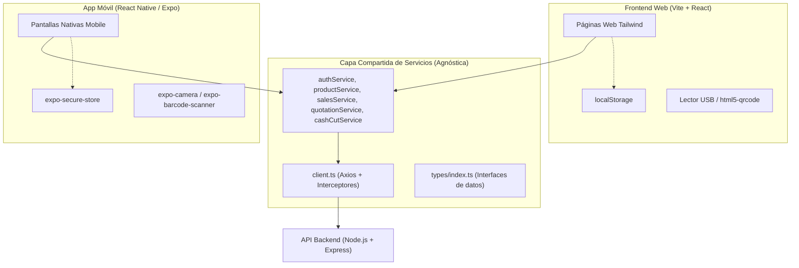

# Guía de Preparación y Reutilización para App Móvil (React Native + Expo)

Esta guía documenta cómo extender el sistema actual a una aplicación nativa para **Android e iOS** utilizando **React Native y Expo**, reutilizando el 100% de la lógica de negocio y los servicios HTTP creados en la Fase 1 y 2.

---

## 1. Arquitectura de Reutilización de Código

Toda la lógica de comunicación con el backend está desacoplada en:
- `frontend/src/api/` (Servicios HTTP agnósticos de la plataforma).
- `frontend/src/types/` (Modelos e interfaces TypeScript).



---

## 2. Pasos para Inicializar la App Móvil con Expo

1. **Crear el proyecto Expo**:
   ```bash
   npx create-expo-app pos-mobile --template blank-typescript
   cd pos-mobile
   ```

2. **Instalar dependencias necesarias**:
   ```bash
   npx expo install axios expo-secure-store expo-camera lucide-react-native
   ```

3. **Copiar las carpetas de servicios**:
   Copia directamente las siguientes dos carpetas de tu frontend web hacia el proyecto móvil:
   - `frontend/src/api/` $\rightarrow$ `pos-mobile/src/api/`
   - `frontend/src/types/` $\rightarrow$ `pos-mobile/src/types/`

---

## 3. Adaptador de Almacenamiento Seguro (Web vs. Móvil)

En la web utilizamos `localStorage`. En React Native / Expo utilizamos `SecureStore` para encriptar los tokens JWT:

```typescript
// pos-mobile/src/api/storage.ts
import * as SecureStore from 'expo-secure-store';

export const mobileStorage = {
  getItem: async (key: string): Promise<string | null> => {
    return await SecureStore.getItemAsync(key);
  },
  setItem: async (key: string, value: string): Promise<void> => {
    await SecureStore.setItemAsync(key, value);
  },
  removeItem: async (key: string): Promise<void> => {
    await SecureStore.deleteItemAsync(key);
  },
};
```

---

## 4. Escáner de Códigos QR con la Cámara Móvil

En la web la terminal soporta pistolas USB y simulación de cámara. En la app móvil se conecta directamente a la cámara del dispositivo usando `expo-camera`, consumiendo exactamente el mismo servicio:

```tsx
// pos-mobile/src/screens/ScannerScreen.tsx
import React, { useState } from 'react';
import { View, Text, StyleSheet } from 'react-native';
import { Camera, CameraView } from 'expo-camera';
import { productService } from '../api/productService';

export default function ScannerScreen({ navigation }: any) {
  const [scanned, setScanned] = useState(false);

  const handleBarcodeScanned = async ({ data }: { data: string }) => {
    if (scanned) return;
    setScanned(true);

    try {
      // Consume el mismo endpoint que la versión web: GET /api/v1/products/qr/:code
      const product = await productService.getByQR(data);
      alert(`Producto escaneado: ${product.name} - Stock: ${product.stock}`);
    } catch (error) {
      alert(`Código QR "${data}" no registrado en el inventario.`);
    } finally {
      setTimeout(() => setScanned(false), 2000);
    }
  };

  return (
    <View style={styles.container}>
      <CameraView
        style={StyleSheet.absoluteFillObject}
        onBarcodeScanned={scanned ? undefined : handleBarcodeScanned}
        barcodeScannerSettings={{
          barcodeTypes: ['qr', 'ean13', 'code128'],
        }}
      />
    </View>
  );
}

const styles = StyleSheet.create({
  container: { flex: 1, backgroundColor: '#000' },
});
```

---

## 5. Ventajas del Desacoplamiento Realizado
- **Cero cambios en el Backend**: La misma API REST soporta la versión web de escritorio, las tablets de mostrador y los teléfonos móviles de los vendedores o almacenistas en pasillo.
- **Mantenimiento Unificado**: Si agregas un nuevo campo a un modelo o un nuevo endpoint, solo actualizas `types/` y `api/` una sola vez.

